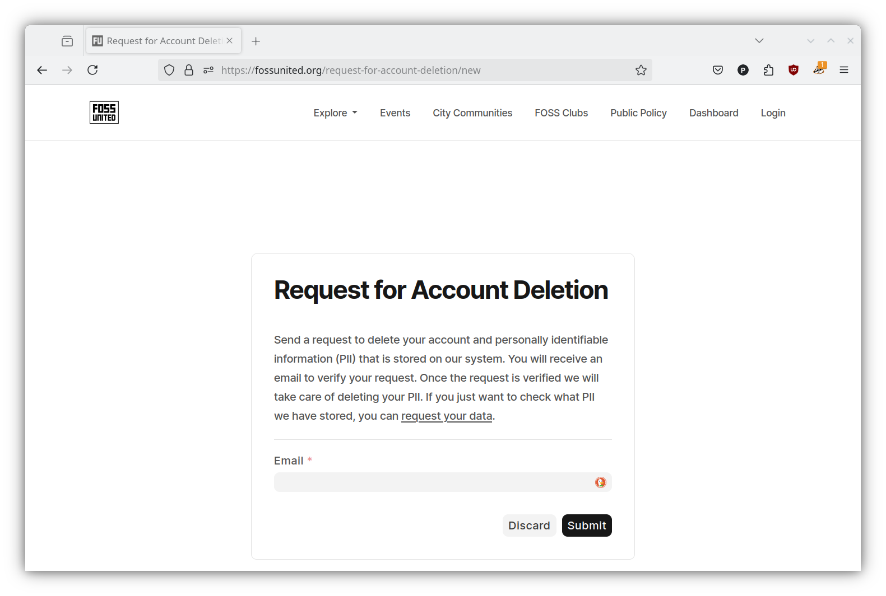

# Delete personal data

If you want us to delete the personal data saved on FOSS United Foundation
systems, including Personally Identifiable Information (PII), submit your email
address on the
[Delete Data](https://fossunited.org/request-for-account-deletion/new) page.

## What happens next

1. You'll receive a confirmation email — click the link to confirm your request.
2. Our team reviews it and completes the deletion, usually within a week.
3. Your account is disabled and your profile is removed: your name, photo, bio,
   contact and social links, location, and your education / work / project
   details. Your public profile page (`/u/<username>`) will no longer be available.

## What is kept

To keep event history and counts accurate without identifying you, some records
are **anonymized** rather than deleted — for example your event RSVPs and talk
proposals no longer show your name or email.

Financial records such as ticket payments are **retained** where we're legally
required to, with your personal details removed.

> We're expanding this coverage in stages. If you have a specific concern about
> where your data appears, mention it in your request and our team will handle it.
